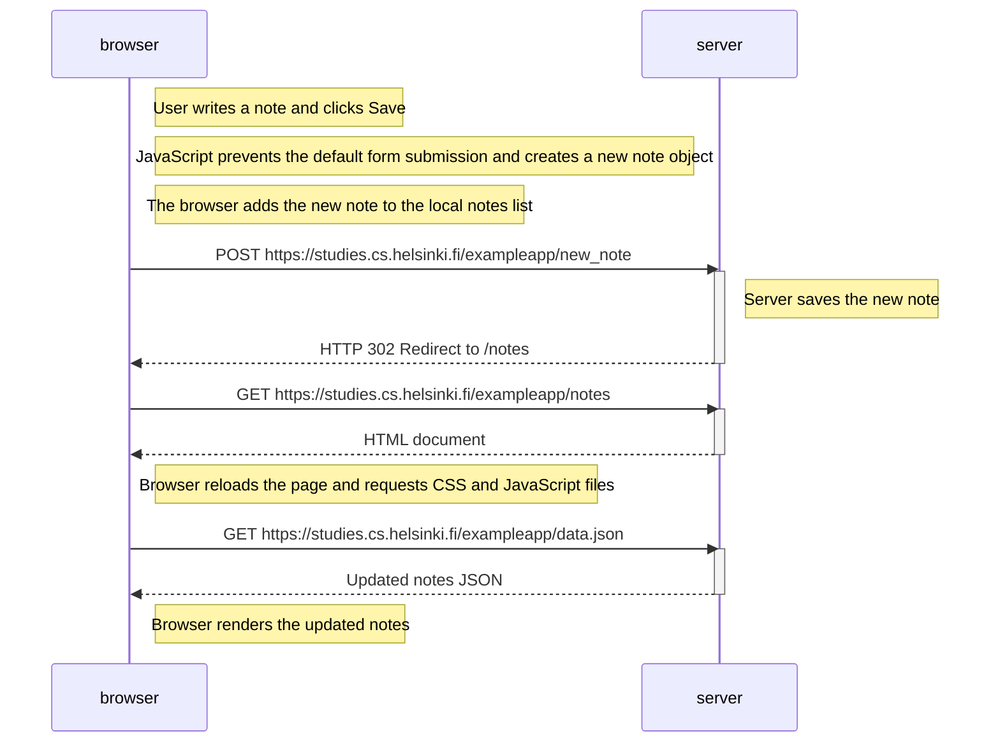

# 0.4: New note diagram

When the user creates a new note, the browser handles the form submission using JavaScript. It creates a new note object, updates the displayed notes, and sends the data to the server using an HTTP POST request.

